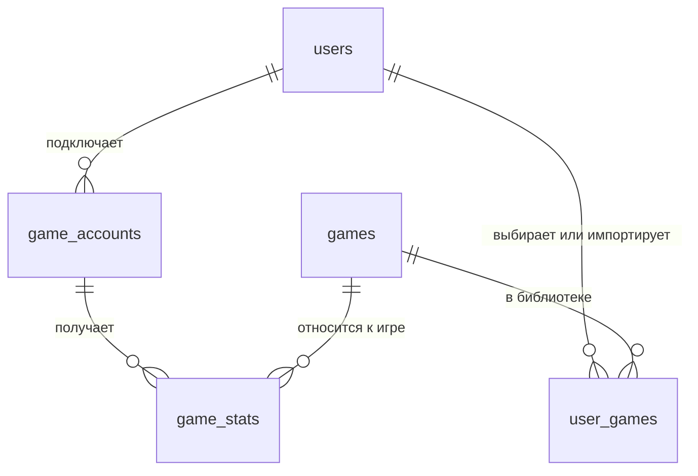

# PartyUp — Telegram-бот для геймеров

Анкеты 18+, поиск тиммейтов и знакомств по играм, временный поиск компании и взаимные лайки. Пользователи общаются через личные сообщения Telegram.

## Запуск через Docker Compose

Запусти Docker Desktop или Docker Engine с Compose. Токен Telegram можно получить командой `/newbot` в [@BotFather](https://t.me/BotFather).

```bash
[ -f .env ] || cp .env.example .env
# Заполни BOT_TOKEN и POSTGRES_PASSWORD в .env.
docker compose up -d --build
docker compose logs -f partyup
```

Когда бот запустится, отправь ему `/start` в личном чате. Ctrl+C закрывает просмотр логов. Команда `docker compose down` останавливает сервисы, данные PostgreSQL остаются в томе `postgres-data`.

Compose запускает PostgreSQL 18 и ждёт, пока он начнёт принимать соединения. Бот применяет миграции Alembic до запуска Telegram polling, затем загружает каталог игр. PostgreSQL доступен боту по внутренней сети Docker, порт базы на хосте не публикуется. Одновременно запускай один экземпляр бота на токен.

### Настройки

| Поле | Значение |
| --- | --- |
| `BOT_TOKEN` | Обязательный токен из @BotFather. Храни его в локальном `.env`. |
| `POSTGRES_PASSWORD` | Обязательный пароль PostgreSQL. Укажи случайный пароль перед первым запуском. |
| `POSTGRES_USER`, `POSTGRES_DB` | Пользователь и имя базы PostgreSQL. По умолчанию оба значения `partyup`. |
| `STEAM_API_KEY` | Необязательный [ключ Steam Web API](https://steamcommunity.com/dev/apikey). При пустом ключе используются открытые данные Steam Community. |
| `FACEIT_API_KEY` | Серверный ключ из [FACEIT App Studio](https://developers.faceit.com/) для статистики CS2. |
| `WOK_API_KEY` | Ключ [WOK Steam API](https://woksteamapi.com/faceit) для статистики CS2, когда `FACEIT_API_KEY` пустой. |
| `DEADLOCK_API_KEY` | Необязательный ключ [Deadlock API](https://api.deadlock-api.com/docs). Ранг и сохранённая история доступны без него. |
| `API_FORTNITE_KEY` | Ключ api-fortnite.com для статистики Fortnite по плейлистам за последние 30 дней. |
| `FORTNITE_API_KEY` | Необязательный ключ fortnite-api.com для резервного получения BR-наигрыша. |
| `UGI_API_KEY` | Ключ основного источника Valorant из [ugiAPI Developer Panel](https://api.ugilabs.com/panel/). |
| `HENRIKDEV_API_KEY` | Ключ для определения сервера и резервной статистики Valorant из [HenrikDev Dashboard](https://api.henrikdev.xyz/dashboard/). |
| `PUBG_API_KEY` | JWT из [PUBG Developer Portal](https://developer.pubg.com/). Нужен для ранга подтверждённого текущего сезона и для Xbox или PlayStation. |
| `PUBG_API_REQUESTS_PER_MINUTE` | Локальный лимит запросов с PUBG JWT. По умолчанию 10. |
| `RIOT_API_KEY` | Необязательный ключ для резервной статистики League of Legends и резервного определения сервера Valorant из [Riot Developer Portal](https://developer.riotgames.com/). |
| `ADMIN_IDS` | Числовые Telegram ID через запятую. Доступ к `/reports`, `/ban`, `/unban` и `/dev`. Свой ID можно получить через `/id` после первого запуска. |
| `DEVELOPER_IDS` | Telegram ID с доступом к `/dev`. |
| `ENABLE_TEST_PROFILES` | По умолчанию `false`. Значение `true` включает `/test` и маркированные вымышленные анкеты в обычном поиске. Тестовые реакции не создают совпадений. |
| `DATA_LOCATION`, `OPERATOR_CONTACT` | Фактическое место хранения данных и контакт для команды `/privacy`. |

## Сценарии бота

- `/start` регистрирует пользователя, сохраняет черновик, предлагает фото или стандартный аватар и показывает предпросмотр. В `/profile` и `/edit` доступны правки по полям, в `/pause` — пауза, в `/delete` — удаление анкеты и связанных записей.
- `/find` показывает анкеты по взаимным фильтрам. `/play` ищет компанию в выбранную игру на четыре часа. `/alerts` управляет одноразовым уведомлением о новой подходящей анкете.
- `/matches` показывает взаимные симпатии и актуальный Telegram `@username` при наличии согласия на обмен контактом. Там же можно пожаловаться или заблокировать анкету.
- «Добавить игры» в главном меню или `/games` открывает общую привязку и ручной выбор игр. Через «Управлять привязками» можно обновить, сменить или отключить сохранённые аккаунты.
- `/dev` открывает диагностику, список анкет, редактирование, предпросмотр подбора и журнал действий. Доступ проверяется по Telegram ID.

### Подключение игр

1. При регистрации предложим ссылку Steam. Игры и доступные ранги появятся в предпросмотре, а привязка сохранится при публикации. В готовой анкете импорт запускается сразу после отправки ссылки через кнопку «Steam».
2. Бот загружает доступную библиотеку. При положительном наигрыше проверяет ранг Dota 2 через OpenDota, уровень CS2 через FACEIT или WOK и ранг Deadlock через Deadlock API. Видимость игровой истории определяется настройками Steam. Остальные игры с наигрышем участвуют в выборе игр для карточки и в подборе.
3. Если в Steam виден наигрыш в PUBG и профиля PUBG ещё нет, бот просит ник или Account ID. По умолчанию проверяется Steam. Для других платформ можно указать `kakao`, `xbox` или `psn` перед ником. Ввод полного Account ID требует `PUBG_API_KEY`. [Документация PUBG](https://documentation.pubg.com/en/players-endpoint.html)
4. Бот предлагает подключить Riot. Одного `Имя#Тег` хватает для поиска League of Legends и Valorant. Если данные есть только для одной игры, они сохраняются сразу, вторую можно повторно проверить через управление привязкой.
5. В «Добавить игры» остаются доступные непривязанные аккаунты и ручной выбор. Для Fortnite нужен ник Epic Games. FACEIT можно дополнительно привязать по нику, ссылке или SteamID64. «Пропустить» переводит на следующий шаг, а «Пропустить всё» завершает предложения. К привязкам можно вернуться позже.

Steam, Riot, Fortnite, PUBG, FACEIT и Deadlock можно подключить при выборе игр или из предпросмотра. Доступные ранги появляются в черновике сразу. Привязку можно сменить или убрать, а при публикации она сохраняется вместе с анкетой без повторного запроса к источнику. Для Deadlock нужна ссылка на Steam. FACEIT можно найти по этому же Steam или указать профиль вручную.

### Карточка и PostgreSQL

В анкете рядом с названием игры показывается доступный ранг, например **Counter-Strike 2 (FACEIT 4)**. Для Fortnite берётся ранг любимого режима за последние 30 дней, включая общий ранг Reload, когда источник возвращает его одним значением. Для PUBG выводится ранг той рейтинговой очереди, где больше всего сохранённого времени выживания среди очередей с рангом. Если ранг недоступен, остаётся название игры. Карточка объединяет до пяти основных игр из Steam или ручного выбора, найденные в Steam игры с поддержкой рангов и дополнительно привязанные игры. Данные берутся из PostgreSQL при открытии карточки.

В PostgreSQL сохраняются:

- **Steam и Dota 2** — SteamID64, доступная библиотека, общее и недавнее время, ранг Dota 2 и доступная оценка игрового времени OpenDota.
- **FACEIT и Deadlock** — идентификаторы, источник, ранг или уровень, Elo, победы и число матчей по доступности. Для Deadlock сохраняется длительность доступных матчей с учётом отметок о выходе.
- **PUBG** — ID, ник и платформа, время выживания и ранги по `solo-fpp`, `solo`, `duo-fpp`, `duo`, `squad-fpp`, `squad`, источники и известный сезон.
- **Riot** — Riot ID, найденные серверы, ранги, число матчей и охват счётчика. LoL использует Solo/Duo, при отсутствии данных — Flex. Для Valorant сохраняется число матчей по доступной истории или сумма рейтинговых матчей за доступные акты.
- **Fortnite** — ID Epic Games, ник, общий наигрыш, активность и ранги по режимам, любимый режим и даты проверок. [Источники и расчёт](docs/fortnite-api.md)

В актуализации PUBG время выживания проверяется отдельно от ранга. Для Steam и Kakao основным источником времени служит [pubg-api.org](https://pubg-api.org/api). Официальный PUBG API даёт ранг текущего сезона и используется для консолей. Для LoL основной источник — OP.GG MCP, запасные — Riot Games API и Iodid. Для Valorant используются ugiAPI и HenrikDev. Для публичного запуска Valorant Riot требует проверять владельца аккаунта через Riot Sign On. [Правила Riot для Valorant](https://developer.riotgames.com/docs/valorant)

## Архитектура

```text
app/
  main.py                Конфигурация, PostgreSQL и запуск polling
  telegram/
    dispatcher.py        Сборка aiogram-роутеров
    routers/             Анкеты, поиск, игровые интеграции, модерация и панель разработчика
    profile_form.py      Общий сценарий регистрации и редактирования
    cards.py             Карточки, фотографии и отображение в ленте
    storage.py           Состояния aiogram в PostgreSQL
  services/              Операции с анкетами, подбором, игровой статистикой и модерацией
  domain/                Валидация анкеты и правила подбора
  persistence/           Модели SQLAlchemy, запись статистики и запуск миграций
  integrations/          Клиенты Steam Web API, Steam Community, OpenDota, FACEIT, WOK, Deadlock, Fortnite, PUBG и Riot
  resources/             Каталог игр, аватар, тестовые данные и отчёт модели
compose.yaml             Бот и PostgreSQL с постоянным томом
alembic.ini              Конфигурация Alembic
migrations/              История изменений схемы PostgreSQL
scripts/                 Воспроизведение эксперимента с подбором игр
tests/                   Проверки сценариев и интеграций
```

Роутеры обрабатывают сообщения и показывают кнопки. `app/services/game_accounts.py` управляет привязками, запросами и обновлением снимков. `app/services/game_labels.py` собирает названия и ранги для карточек.

### Схема PostgreSQL



| Таблица | Что хранит |
| --- | --- |
| `users` | Telegram ID, анкету, настройки и статус пользователя. |
| `games` | Общий каталог. Steam AppID сохранены в качестве идентификаторов, а для игр вне Steam выделены отдельные значения. `slug` задаёт уникальное имя для ссылки на запись. |
| `user_games` | Ручной выбор, импортированную библиотеку Steam и минуты, которые используются в подборе. Ключ состоит из `user_id` и `game_id`. |
| `game_accounts` | Привязку пользователя к Steam, Riot, Epic, FACEIT или PUBG. Хранит внешний ID, статус и дату проверки. На пользователя доступна одна привязка каждой платформы. |
| `game_stats` | Один снимок на пару `account_id` и `game_id`. Общие поля включают ранг, матчи, минуты, источник, охват и дату. `details` в JSONB хранит особые поля, например очереди PUBG, режимы Fortnite, Elo FACEIT и точную длительность матчей Deadlock. |

Valorant и League of Legends используют одну привязку Riot и две строки в `game_stats`. Статистика Dota 2 и Deadlock относится к привязке Steam. При удалении привязки PostgreSQL каскадно удаляет её статистику. Анкета показывает название и доступный ранг.

### Миграции Alembic

Ревизия `0001` создаёт схему на пустой PostgreSQL. Для старой схемы без Alembic этот переход предусматривает создание чистой базы. Обычный запуск с обнаруженной старой схемой остановится до изменения таблиц.

```bash
docker compose up -d --wait db
docker compose run --rm --no-deps partyup /app/.venv/bin/alembic current
docker compose run --rm --no-deps partyup /app/.venv/bin/alembic upgrade head
```

После изменения моделей создай ревизию через `alembic revision --autogenerate -m "описание"` в рабочей копии, подключённой к базе с последней ревизией. Проверь сгенерированные операции и их откат перед коммитом. `alembic check` сверяет модели с применённой схемой.

Лента рассчитывает игровой балл с весами 60/30/10 для главной общей игры, остальных общих игр и жанров. При равных баллах учитывается пересечение расписания. `/model` отправляет отдельно обученную модель сходства игр и её отчёт. Скрипт обучения и производная база описаны в [DATA_LICENSE.md](DATA_LICENSE.md). Чтобы повторить обучение, запусти `uv run --locked --extra training --python 3.12 scripts/train_model.py --csv /path/to/steam-200k.csv`.

## Проверки

Для тестов с базой задай `PARTYUP_TEST_DATABASE_URL` для отдельной базы PostgreSQL. Тесты создают и удаляют изолированные схемы. Ответы Telegram и Steam подменяются.

```bash
uv run --locked --extra dev --python 3.12 -m pytest -q
uv run --locked --extra dev --python 3.12 ruff check app migrations scripts tests
```

`pyproject.toml` задаёт зависимости, `uv.lock` фиксирует их версии для Docker и тестов.
