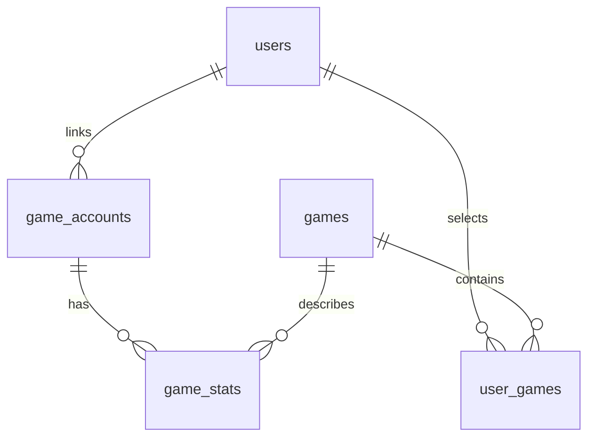

# PartyUp — Telegram-бот для геймеров

Анкеты 18+, поиск тиммейтов и знакомств по играм, временный поиск компании и взаимные лайки. Бот импортирует игровую статистику и помогает находить подходящих игроков. Общение происходит в личных сообщениях Telegram.

**Стек:** Python 3.12, aiogram 3, PostgreSQL 18, SQLAlchemy 2, Alembic, HTTPX, Pydantic Settings, Docker Compose, uv, pytest, Ruff.

## Запуск через Docker Compose

Получить токен бота можно командой `/newbot` в [@BotFather](https://t.me/BotFather).

```bash
[ -f .env ] || cp .env.example .env
# Заполни BOT_TOKEN и POSTGRES_PASSWORD в .env
docker compose up -d --build
docker compose logs -f partyup
```

После запуска отправь боту `/start`. Compose поднимает PostgreSQL, дожидается готовности базы и запускает бота. Миграции Alembic применяются автоматически до начала polling. Порт PostgreSQL не публикуется на хосте.

`docker compose up --build` запускает сервисы с выводом логов в терминал. `docker compose down` останавливает их, сохраняя данные в томе `postgres-data`. Не запускай несколько экземпляров polling с одним токеном.

### Настройки

Все переменные перечислены в [`.env.example`](.env.example). Секреты хранятся в локальном `.env`.

| Переменная | Назначение |
| --- | --- |
| `BOT_TOKEN`, `POSTGRES_PASSWORD` | Обязательные токен бота и пароль БД. |
| `POSTGRES_USER`, `POSTGRES_DB` | По умолчанию `partyup`. |
| `STEAM_API_KEY` | [Steam Web API](https://steamcommunity.com/dev/apikey); без ключа используется Steam Community. |
| `FACEIT_API_KEY`, `WOK_API_KEY` | [FACEIT](https://developers.faceit.com/) и [WOK](https://woksteamapi.com/faceit) для CS2. |
| `DEADLOCK_API_KEY` | Необязательный ключ [Deadlock API](https://api.deadlock-api.com/docs). |
| `API_FORTNITE_KEY`, `FORTNITE_API_KEY` | Источник активности по плейлистам и резервный источник BR-наигрыша. |
| `API_FORTNITE_DAILY_LIMIT` | Локальный суточный лимит api-fortnite.com. |
| `UGI_API_KEY`, `HENRIKDEV_API_KEY` | [ugiAPI](https://api.ugilabs.com/panel/) и [HenrikDev](https://api.henrikdev.xyz/dashboard/) для Valorant. |
| `RIOT_API_KEY` | Необязательный резервный [Riot API](https://developer.riotgames.com/). |
| `PUBG_API_KEY` | [PUBG API](https://developer.pubg.com/): ранг текущего сезона, консольные профили и поиск по Account ID. |
| `PUBG_API_REQUESTS_PER_MINUTE` | Локальный лимит официального PUBG API, по умолчанию 10. |
| `ADMIN_IDS`, `DEVELOPER_IDS` | Telegram ID через запятую для модерации и панели разработчика. |
| `ENABLE_TEST_PROFILES` | По умолчанию `false`; включает маркированные тестовые анкеты и `/test` без реальных мэтчей с ними. |
| `DATA_LOCATION`, `OPERATOR_CONTACT` | Информация для `/privacy`. |

### Логи API

`docker compose logs -f partyup` показывает журнал приложения. Логгер `app.api` фиксирует поставщика, операцию, HTTP-статус, время ответа, сетевые ошибки, ограничения и пропущенные запросы. Для Telegram фиксируется результат операции; успешный polling не засоряет INFO-логи.

```text
provider=steam_web operation=GetOwnedGames method=GET status=200 elapsed_ms=84
provider=faceit operation=cs2_stats method=GET status=429 elapsed_ms=210 retry_after_s=60
```

Примеры условные. В этих записях не выводятся URL запросов, ключи, заголовки и тела запросов.

## Возможности

- `/start`, `/profile`, `/edit`, `/pause`, `/delete` — создание и управление анкетой.
- `/find`, `/play`, `/alerts` — поиск по взаимным фильтрам, компания на четыре часа и уведомления.
- `/matches` — взаимные лайки, обмен контактами с согласия пользователей, жалобы и блокировки.
- `/games` — выбор игр, подключение аккаунтов, обновление и отключение привязок.
- `/dev` — диагностика, управление анкетами, предпросмотр подбора и журнал действий.

### Игровые интеграции

| Игра / платформа | Подключение | Данные и источники |
| --- | --- | --- |
| Steam | Ссылка на профиль | Библиотека, общий и недавний наигрыш — Steam Web API / Steam Community. |
| Dota 2 | Steam | Ранг и оценка времени по доступной истории — OpenDota. |
| CS2 / FACEIT | Steam, ник или ссылка FACEIT | Уровень, Elo, матчи и победы — FACEIT / WOK. |
| Deadlock | Steam | Ранг, матчи и длительность доступных матчей — Deadlock API. |
| PUBG | Ник или Account ID | Время выживания и ранги по Solo, Duo, Squad отдельно для FPP/TPP — pubg-api.org / официальный PUBG API. |
| League of Legends | Riot ID | Ранг Solo/Duo или Flex, матчи — OP.GG MCP / Riot / Iodid. |
| Valorant | Riot ID | Ранг и матчи по доступной истории — ugiAPI / HenrikDev. |
| Fortnite | Ник Epic Games | Общий наигрыш, активность и ранги по режимам — Osirion, api-fortnite.com, fortnite-api.com. [Подробнее](docs/fortnite-api.md). |

При импорте Steam бот проверяет Dota 2 и, при наличии наигрыша, FACEIT и Deadlock. При обнаружении PUBG предлагает указать игровой ник или Account ID. Один Riot ID используется для обеих игр Riot.

Аккаунты можно подключать при создании анкеты или через `/games`. Статистика черновика сохраняется при публикации без повторного обращения к API. Карточки читают сохранённые ранги из PostgreSQL. Данные сторонних API могут быть неполными; для публичного запуска Valorant необходимо учитывать [требования Riot Sign On](https://developer.riotgames.com/docs/valorant).

## Архитектура

```text
app/
  main.py          Запуск приложения и сборка зависимостей
  telegram/        Роутеры, FSM, карточки и сценарии бота
  services/        Анкеты, подбор и управление игровыми аккаунтами
  domain/          Доменные модели, валидация и правила подбора
  persistence/     SQLAlchemy-модели и работа с PostgreSQL
  integrations/    Клиенты игровых API и общее логирование HTTP
  resources/       Каталог игр и ресурсы
migrations/        Миграции Alembic
scripts/           Обучение и эксперименты
tests/             Тесты
```

Игровые привязки обслуживает `GameAccounts` в `app/services/game_accounts.py`. Telegram использует единый сценарий привязки вместо отдельных роутеров каждой игры. Сервисы конкретных игр преобразуют ответы поставщиков в общую модель хранения.

### Схема PostgreSQL



| Таблица | Назначение |
| --- | --- |
| `users` | Telegram ID, анкета и настройки пользователя. |
| `games` | Единый каталог игр со стабильными ID и уникальными slug. |
| `user_games` | Ручной выбор, импорт Steam и наигрыш для подбора. |
| `game_accounts` | Внешний аккаунт, платформа, статус и дата проверки. Одна привязка на пару пользователь / платформа. |
| `game_stats` | Снимок на пару аккаунт / игра: ранг, матчи, минуты, источник, охват, дата проверки. Специфические поля хранятся в JSONB `details`. |

LoL и Valorant используют один Riot-аккаунт и два снимка статистики. Dota 2 и Deadlock используют Steam-аккаунт. Удаление привязки каскадно удаляет её статистику.

Текущий алгоритм подбора учитывает общие игры, наигрыш и жанры (60/30/10 для главной общей игры, остальных общих игр и жанров), а при равном балле — расписание. Ранги отображаются в карточках, но пока не входят непосредственно в формулу балла.

### Миграции

На пустой базе Alembic создаёт схему с нуля. Если том содержит PostgreSQL из версии PartyUp до Alembic, первый запуск на этом же томе обновляет схему и переносит игровой импорт, привязки и статистику. Анкеты, каталог, реакции и история сохраняются. Перед обновлением сделай резервную копию базы.

Если раньше в LoL и Valorant были привязаны разные Riot ID, активным становится ID из последней проверки. Второй снимок сохраняется в `game_accounts.details.previous_profiles`.

```bash
docker compose up -d --wait db
docker compose run --rm --no-deps partyup /app/.venv/bin/alembic current
docker compose run --rm --no-deps partyup /app/.venv/bin/alembic upgrade head
```

При изменении ORM-моделей создай и проверь новую ревизию (`alembic revision --autogenerate -m "описание"`). Команда `alembic check` проверяет соответствие моделей применённой схеме.

## Проверки

```bash
uv run --locked --extra dev --python 3.12 -m pytest -q
uv run --locked --extra dev --python 3.12 ruff check app migrations scripts tests
```

Для тестов с БД задай `PARTYUP_TEST_DATABASE_URL` для отдельной PostgreSQL. Тесты используют изолированные схемы и подменяют внешние ответы.

Зависимости фиксируются в `uv.lock`. Обучение отдельной модели сходства игр описано в [DATA_LICENSE.md](DATA_LICENSE.md); для воспроизведения используется `scripts/train_model.py` и extra `training`.
