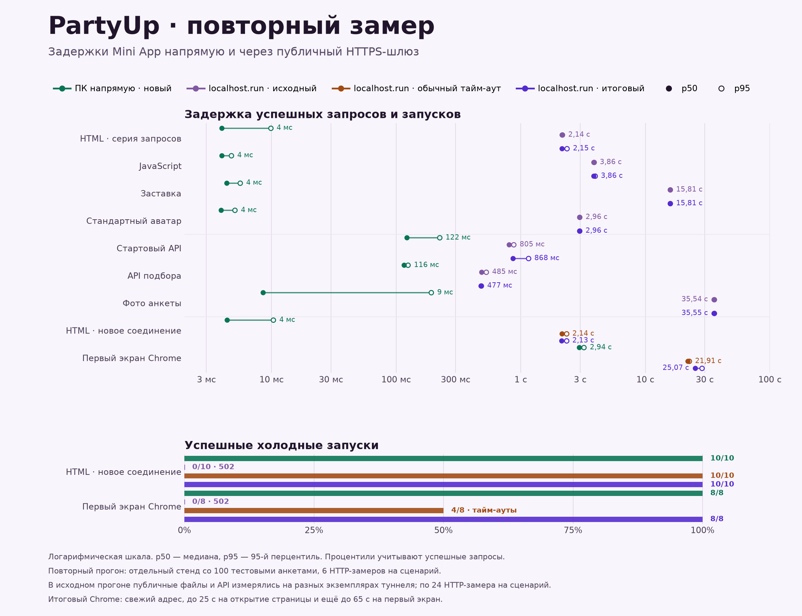

# Повторный замер PartyUp за 26 ноября 2026 года

| Сценарий | ПК напрямую, p50 | localhost.run, p50 | Успех через туннель |
| --- | ---: | ---: | ---: |
| HTML с новым соединением | 4,4 мс | 2,13 с | 10/10 |
| Стартовый API | 122 мс | 868 мс | 6/6 |
| Заставка | 4,4 мс | 15,81 с | 6/6 |
| Фото анкеты, 144 КиБ | 8,6 мс | 35,55 с | 6/6 |
| Первая карточка в Chrome | 2,94 с | 25,07 с | 8/8 |

[Сводные значения p50, p95 и число успешных попыток](comparison.csv)

Запросы шли с одного ПК к изолированному стенду PartyUp со 100 синтетическими анкетами. Для файлов и API выполнено по шесть запросов на сценарий. В итоговом запуске Chrome открывал страницу с чистым контекстом браузера. На загрузку страницы отводилось до 25 секунд, затем до 65 секунд на появление карточки. При обычных лимитах в 12 и 15 секунд первый экран загрузился в 4 из 8 попыток.

Для итоговых замеров HTTP и Chrome использовались два адреса одного провайдера. После серии HTTP-запросов `localhost.run` выдал новый адрес, а прежний ответил `502 no tunnel`. Chrome повторно проверили на свежем адресе. Пять проверок до прогона и три после него вернули `200`. Медиана получения фото через туннель составила 35,55 с при 35,54 с в исходном прогоне.
